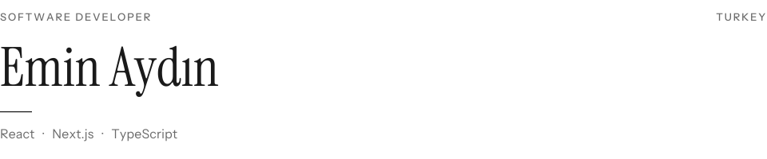

<picture>
  <source media="(prefers-color-scheme: dark)" srcset="./assets/header-dark.svg" />
  
</picture>

I build the interface of products that stay in use. Operational dashboards, admin panels, and customer-facing web applications, taken through to production.

[GitHub](https://github.com/eminaydin0) · [LinkedIn](https://www.linkedin.com/in/emin-ayd%C4%B1n-991139224/) · [Instagram](https://www.instagram.com/emnaydn0) · [kuraline.xyz](https://kuraline.xyz)

## Selected work

**01** &nbsp;&nbsp; **[gaiPsychology](https://gaipsychology.com/)**  
Exercises, assessments, and the tools centers use day to day.

**02** &nbsp;&nbsp; **[OmegaTree](https://app.omegatree.com.tr/giris)**  
Stock, process, and day-to-day operations.

**03** &nbsp;&nbsp; **[Alo Hasar](https://app.aloyonetim.com/)**  
Damage operations panel, with Dreaxm AI in the workflow.

**04** &nbsp;&nbsp; **[Kuralı Ne?](https://kuraline.xyz)**  
Rules, score tools, and guides for traditional and digital games.

## Stack

**Interface** — TypeScript, React, Next.js, Tailwind CSS  
**Application** — Node.js, Express, PostgreSQL, MySQL, Prisma, Supabase  
**Delivery** — Git, Docker, Vercel, Linux

## GitHub

<picture>
  <source media="(prefers-color-scheme: dark)" srcset="https://github-readme-stats.vercel.app/api?username=eminaydin0&amp;show_icons=true&amp;hide_border=true&amp;hide_rank=true&amp;disable_animations=true&amp;card_width=460&amp;bg_color=00000000&amp;title_color=A3A3A3&amp;text_color=F2F2F2&amp;icon_color=A3A3A3&amp;include_all_commits=true&amp;custom_title=Activity" />
  
</picture>
<picture>
  <source media="(prefers-color-scheme: dark)" srcset="https://github-readme-stats.vercel.app/api/top-langs/?username=eminaydin0&amp;layout=compact&amp;hide_border=true&amp;card_width=380&amp;bg_color=00000000&amp;title_color=A3A3A3&amp;text_color=F2F2F2&amp;langs_count=6&amp;custom_title=Languages" />
  
</picture>

Open to collaboration.
